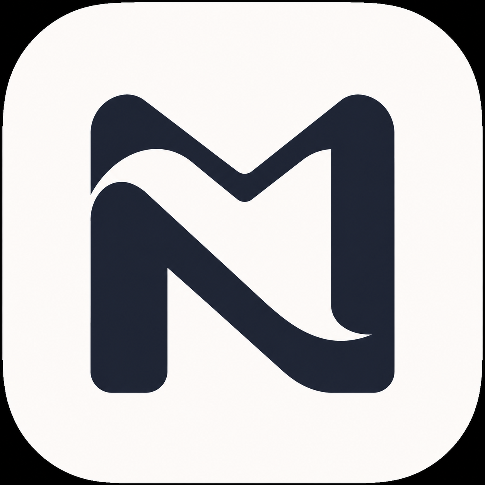
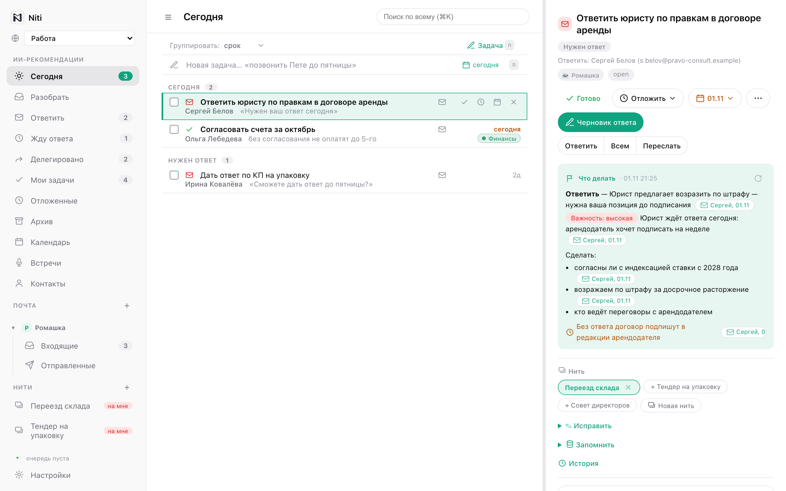
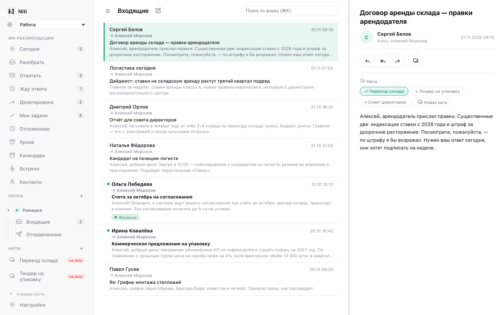
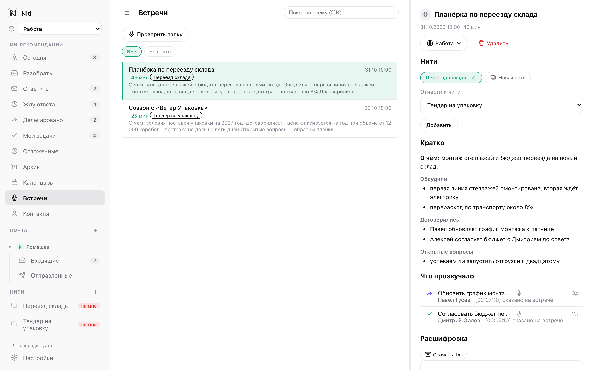
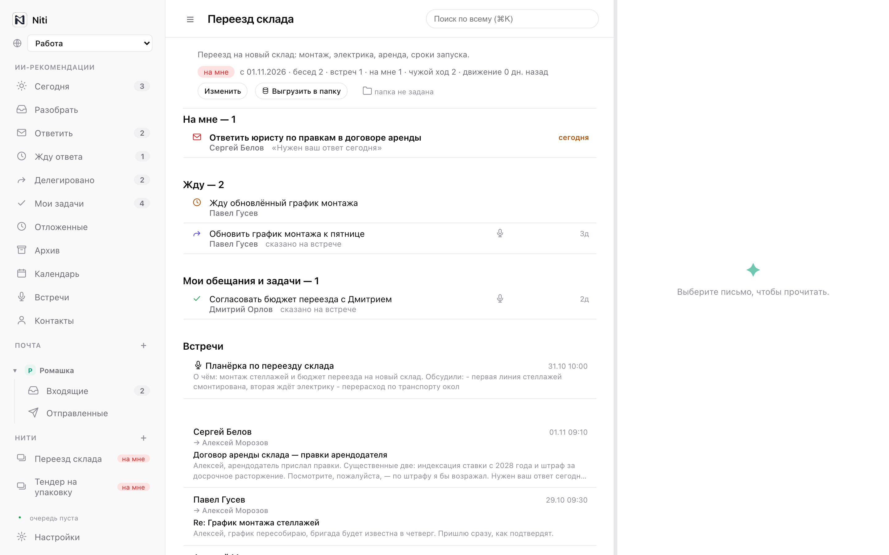
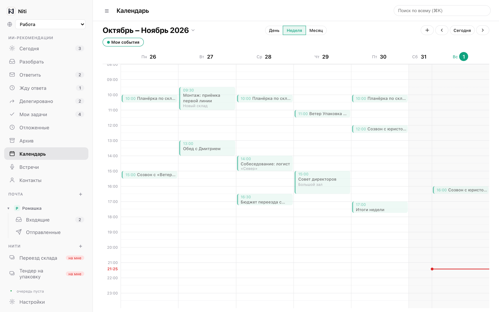
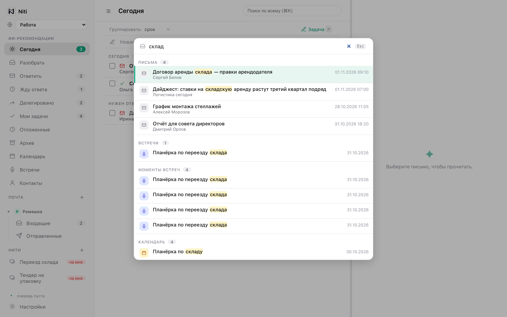
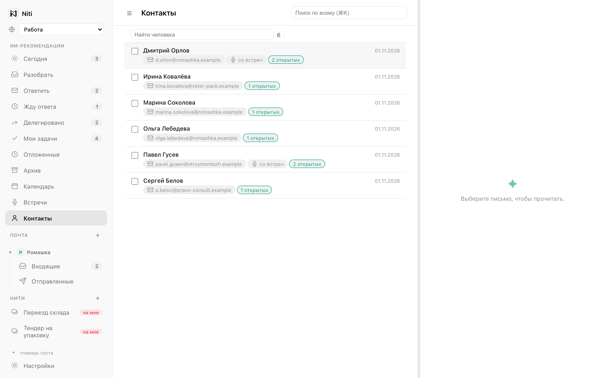
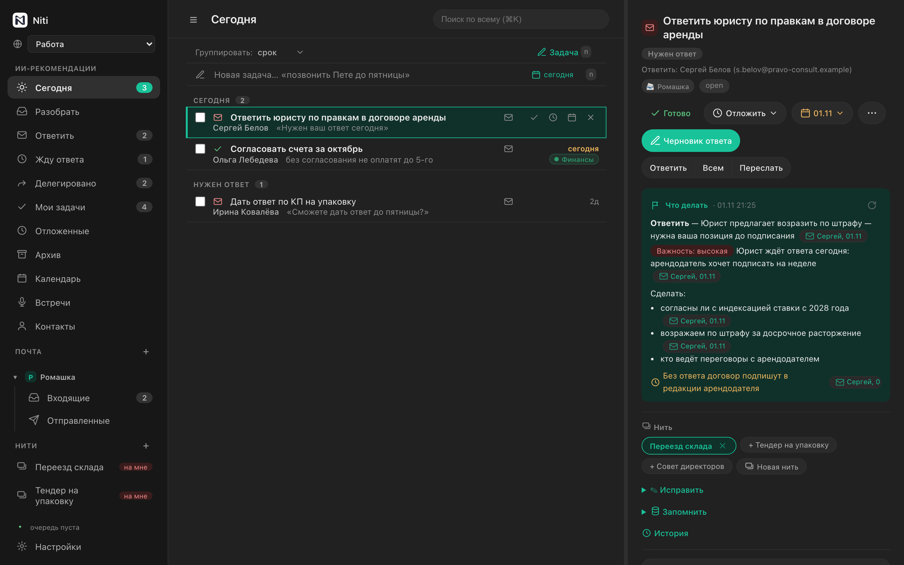

<p align="center">
  
</p>

<h1 align="center">Niti</h1>

<p align="center">
  Личное приложение для Mac, которое превращает почту, встречи, календарь и Telegram<br>
  в <b>обязательства</b>: что я обещал, чего жду от других, что ждёт моего ответа, что я передал.
</p>

<p align="center"></p>

> Почта — это вход, а не продукт. Продукт — состояние обязательств.

*In English: Niti is a local-first macOS app that reads your mailboxes, meeting transcripts,
calendars and Telegram and turns them into tracked commitments — what you promised, what you
are waiting for, what needs your reply, what you delegated. An LLM of your choice does the
extraction; everything else stays on your Mac. The UI is in Russian.*

## Что умеет

- **Обязательства из переписки.** Модель читает беседу и заводит карточки: «Нужен мой ответ»,
  «Жду ответа», «Обещал», «Передано», задача себе. Каждая карточка ссылается на письмо или
  на момент встречи, из которого она взялась; у каждой — срок, откладывание, исправление рукой.
- **Доски.** Сегодня · Разобрать · Ответить · Жду ответа · Делегировано · Мои задачи ·
  Отложенные · Архив. Свои доски — сохранённые фильтры. Быстрое добавление строкой по-русски:
  «позвонить Пете до пятницы» — без модели.
- **Совет по карточке.** Почему это важно сейчас, какой мой следующий шаг, что не забыть в
  ответе — и каждое утверждение со ссылкой на конкретное письмо.
- **Черновики.** Ответ, напоминание, поручение — попадают в обычную форму письма. **Сам Niti
  ничего не отправляет**: письмо уходит только нажатием человека.
- **Нити.** Темы поверх бесед, встреч и карточек. Их состояние — «на мне», «жду», «пора
  напомнить», «затухла» — не вводится руками, а сворачивается из обязательств.
- **Встречи.** Расшифровки из приложения-диктофона: сводка по разделам («О чём», «Обсудили»,
  «Договорились», «Открытые вопросы»), задачи, сказанные на встрече, раскладка по Нитям.
- **Почта и календарь.** Почтовый клиент для Gmail, Яндекса и любого IMAP; календарь
  (день, неделя, месяц) через CalDAV, создание и правка событий.
- **Поиск ⌘K** по письмам, карточкам, встречам, событиям и людям — полнотекстовый, по основам
  русских слов.
- **Пространства.** «Работа» и «Личное» не смешиваются: у каждого свои ящики, доски, Нити и
  своя модель.
- **Память и контакты.** Человек — профиль с адресами, заметками и фактами; факты о себе и
  людях модель только предлагает, с цитатой-источником, принимает их человек.
- **MCP-сервер.** Внешний агент (Claude, goose и др.) может читать контекст и вести карточки и
  черновики. Отправки писем в MCP нет вовсе — это ограничение кода, а не инструкция агенту.

## Скриншоты

| | |
|---|---|
|  Почта: письмо и его Нити |  Встреча: сводка и задачи с неё |
|  Нить: что на мне, чего жду, встречи и беседы |  Календарь недели |
|  Поиск ⌘K |  Контакты |

<p align="center"><br><sub>Тёмная тема включается вместе с системной.</sub></p>

Все данные на скриншотах вымышлены.

## Установка

Нужен Mac на Apple Silicon с macOS 13 или новее.

1. Скачайте `Niti.dmg` со страницы [Releases](../../releases) и перетащите Niti в «Программы».
2. Сборка не подписана сертификатом Apple, поэтому при первом запуске macOS её заблокирует.
   Снимите карантин одной командой:

   ```bash
   xattr -dr com.apple.quarantine /Applications/Niti.app
   ```

   или после первой попытки запуска откройте Системные настройки → Конфиденциальность и
   безопасность и нажмите «Всё равно открыть» напротив Niti.

3. Настройки → Пространства → подключите почтовый ящик. Gmail и Яндекс требуют **пароль
   приложения** (обычный пароль по IMAP больше не работает), мастер подскажет, где его взять,
   и проверит вход.
4. Настройки → AI / извлечение → подключите модель: Anthropic, OpenRouter, любой OpenAI-совместимый
   шлюз (LiteLLM, RouterAI) или локальную модель (llama.cpp, LM Studio, Ollama).

Niti забирает почту за последние 90 дней, а моделью разбирает беседы последних 30 дней: первый
проход занимает время и расходует токены модели.

## Данные и приватность

- Всё хранится локально: база SQLite, кэш вложений и ключ шифрования лежат в
  `~/Library/Application Support/Niti`. Пароли ящиков и ключи моделей зашифрованы.
- Бэкенд слушает только `127.0.0.1`.
- **Текст писем и расшифровок уходит в ту модель, которую вы подключили.** Если это облачный
  провайдер, он видит то, что разбирает. Для полной локальности подключите локальную модель.
- Массовые рассылки отсекаются без модели и в разбор не идут.

## Встречи

Niti не записывает звук сам: расшифровки приносит приложение-диктофон. Договор — папка:
на каждую встречу диктофон кладёт JSON в `~/Library/Application Support/Niti/artifacts_inbox`:

```json
{
  "meeting_id": "2026-11-01-1000",
  "started_at": "2026-11-01T10:00:00+03:00",
  "duration_sec": 1800,
  "asr_root": "/Users/you/Recordings",
  "transcript_path": "2026-11/planerka.txt",
  "srt_path": null,
  "audio_path": null,
  "source": "my-recorder"
}
```

Пути — относительно `asr_root`; сами файлы Niti только читает. Строки расшифровки вида
`[00:05:30] Спикер: текст`.

## Внешние агенты (MCP)

Настройки → Безопасность → «Доступ для внешнего агента (MCP)»: включите доступ, там же
адрес вида `http://127.0.0.1:<порт>/mcp`, токен и готовая команда для Claude Code. Правила
работы для агента — в навыке [`.claude/skills/niti-agent`](.claude/skills/niti-agent/SKILL.md).

## Сборка из исходников

Понадобятся [uv](https://docs.astral.sh/uv/) и Xcode Command Line Tools (`swift`).

```bash
git clone https://github.com/shpilkin/niti-open.git && cd niti-open
uv sync --extra build --extra dev
packaging/build_app.sh            # → dist/Niti.app
MAKE_DMG=1 packaging/build_app.sh # → и dist/Niti.dmg
```

Подпись и нотаризация — через переменные `SIGN_IDENTITY` и `NOTARY_PROFILE`
(см. начало `packaging/build_app.sh`).

Запуск без сборки, в браузере:

```bash
export EMAIL_READER_DATA_DIR=~/niti-dev   # отдельный каталог данных
uv run email-reader migrate
uv run email-reader all                   # интерфейс на http://127.0.0.1:8000
```

## Разработка

```bash
uv run pytest -q                        # модульные тесты
uv run playwright install chromium      # один раз
uv run pytest -m e2e tests/e2e -q       # сквозные тесты в браузере
uv run ruff check .
```

Стек: Python 3.12, FastAPI, SQLAlchemy (async) + Alembic, Jinja2 + htmx; оболочка — Swift/AppKit
с WKWebView; бэкенд вмораживается в `.app` PyInstaller'ом. Интерфейс следует дизайн-системе:
токены в `static/tokens.css`, правила и компоненты — в [DESIGN.md](DESIGN.md).

Этот репозиторий публикуется снимками из рабочего репозитория автора. Issues и pull requests
приветствуются; принятые изменения переносятся вручную.

## Ограничения

- Только macOS и один пользователь.
- Интерфейс на русском.
- Почта — по IMAP с опросом; Gmail API и Microsoft Graph не поддерживаются.
- Вложения внешнему агенту по MCP не видны — только признак «есть вложения».

## Лицензия

[MIT](LICENSE)
